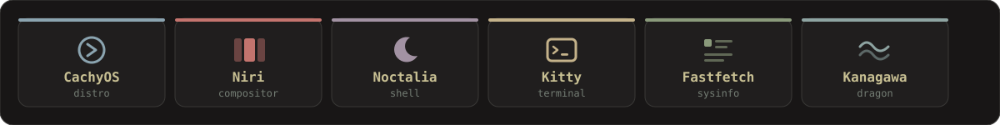
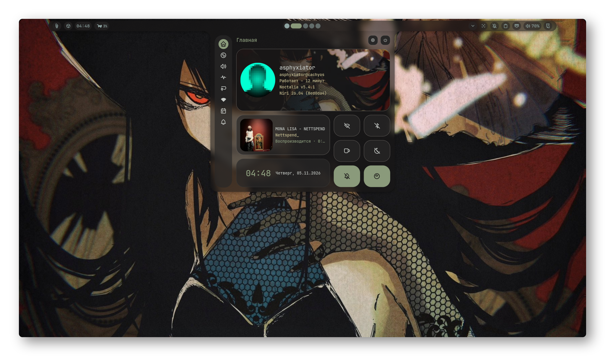
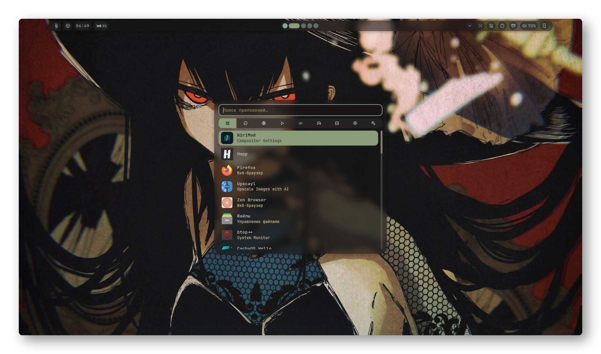
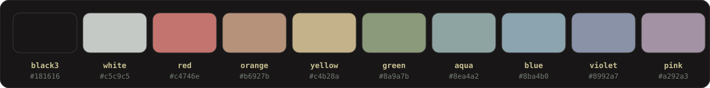

<div align="center">



<br>



<br>


<br><br>

**[Preview](#preview)** &nbsp;·&nbsp; **[What's inside](#whats-inside)** &nbsp;·&nbsp; **[Structure](#structure)** &nbsp;·&nbsp; **[Install](#install)** &nbsp;·&nbsp; **[Palette](#palette)** &nbsp;·&nbsp; **[FAQ](#faq)**

</div>

<br>

My first proper Linux rice, built right after moving to **CachyOS**. It's a quiet **Wayland** desktop on the **Niri** scrollable-tiling compositor with the **Noctalia** shell, painted in **Kanagawa Dragon** colors: dark, a bit warm, nothing screaming for attention.

I wanted a setup that stays out of the way. The configs are split into small files, so you can steal single pieces without pulling in the whole thing.

> [!NOTE]
> It's a work in progress. I'm new to ricing, so expect things to change as I figure out what I like.

<br>

<h2 id="preview"></h2>

<div align="center">


<sub>Cmatrix - Terminal - Lazyvim - Cava</sub>

<br><br>

<table>
  <tr>
    <td width="50%" align="center">
      
      <br><sub>Desktop Preview</sub>
    </td>
    <td width="50%" align="center">
      
      <br><sub>Kitty + Fastfetch</sub>
    </td>
  </tr>
    <tr>
    <td width="50%" align="center">
      
      <br><sub>Preview Control Center</sub>
    </td>
    <td width="50%" align="center">
      
      <br><sub>Preview App Launcher</sub>
    </td>
  </tr>
</table>

</div>

<!--
  More screenshots later? Drop the files into /screenshots and add another <tr> above:
  <tr>
    <td width="50%" align="center"><br><sub>Caption</sub></td>
    <td width="50%" align="center"><br><sub>Caption</sub></td>
  </tr>
-->

<br>

<h2 id="whats-inside"></h2>

| | |
|:--|:--|
| **OS** | [CachyOS](https://cachyos.org/), Arch-based, tuned for speed |
| **Compositor** | [Niri](https://github.com/YaLTeR/niri), a scrollable-tiling Wayland compositor |
| **Shell** | [Noctalia](https://github.com/noctalia-dev/noctalia-shell), bar, launcher, notifications and the rest |
| **Terminal** | [Kitty](https://sw.kovidgoyal.net/kitty/) |
| **System info** | [Fastfetch](https://github.com/fastfetch-cli/fastfetch) with a custom config |
| **Colors** | [Kanagawa Dragon](https://github.com/rebelot/kanagawa.nvim) |
| **Session** | Wayland |

### Why Niri?

Windows in Niri live on an endless horizontal strip instead of being squeezed into a grid. Opening a new window never resizes the ones you already have, you just scroll sideways. If you've never tried it, [the Niri README](https://github.com/YaLTeR/niri) is a good place to start.

<br>

<h2 id="structure"></h2>

The Niri config is split into small files instead of one giant `config.kdl`, so it's easy to find things and easy to borrow only what you need.

```text
cachyos-rice/
├── niri/
│   ├── config.kdl          # entry point, just includes the rest
│   ├── noctalia.kdl        # Noctalia integration
│   └── cfg/
│       ├── animation.kdl
│       ├── autostart.kdl
│       ├── display.kdl
│       ├── input.kdl
│       ├── keybinds.kdl
│       ├── layout.kdl
│       ├── misc.kdl
│       └── rules.kdl
├── noctalia/
│   └── config.toml
├── kitty/
│   ├── kitty.conf
│   └── themes/noctalia.conf
├── fastfetch/
│   └── config.jsonc
├── wallpapers/
│   └── wallpaper.jpg
└── screenshots/
```

<br>

<h2 id="install"></h2>

> [!WARNING]
> These are my personal dotfiles and they're written for my machine. Monitor names, keybinds and autostart commands **will** need adjusting on yours. Read before you copy.

**1. Install the basics**

```bash
sudo pacman -S niri kitty fastfetch
```

Noctalia isn't in this one-liner, so follow the [install guide in its repo](https://github.com/noctalia-dev/noctalia-shell) for your setup.

**2. Clone the repo**

```bash
git clone https://github.com/mejivith/cachyos-rice.git
cd cachyos-rice
```

**3. Back up what you have**

```bash
mkdir -p ~/.config-backup
for d in niri noctalia kitty fastfetch; do
  [ -d ~/.config/$d ] && cp -a ~/.config/$d ~/.config-backup/
done
```

**4. Copy the configs you want**

```bash
cp -a niri noctalia kitty fastfetch ~/.config/
```

Only want the terminal? Copy just `kitty` and `fastfetch`. Only curious about the Niri layout? Take `niri/cfg/layout.kdl` and `animation.kdl`. Nobody says you need everything.

The wallpaper lives in [`wallpapers/`](wallpapers), set it up through Noctalia or however you normally do.

**5. Log out and back in** if you replaced your Niri config. Before you do, make sure Niri can parse it:

```bash
niri validate
```

<br>

<h2 id="palette"></h2>

I'm using the [Kanagawa Dragon](https://github.com/rebelot/kanagawa.nvim) variant. Here's the palette I built the look around:



<br>

<h2 id="faq"></h2>

<details>
<summary><b>Will this work on Arch, Fedora or another distro?</b></summary>
<br>
Probably, yes. As far as I know nothing in here is CachyOS-specific. If Niri, Kitty, Fastfetch and Noctalia run on your system, the configs should too. The only thing that changes between distros is how you install the packages.
</details>

<details>
<summary><b>Is this a Hyprland rice?</b></summary>
<br>
No, it's Niri. It's a different kind of compositor: scrollable tiling instead of a classic grid. If you're coming from Hyprland, the keybind and layout files are the best place to see how the two differ.
</details>

<details>
<summary><b>Which Noctalia version is this for?</b></summary>
<br>
The one I'm running at the time of writing. Noctalia moves fast, so if something looks off, check the config format in <a href="https://github.com/noctalia-dev/noctalia-shell">their repo</a> first.
</details>

<details>
<summary><b>Can I use your wallpaper?</b></summary>
<br>
Sure, grab it from <a href="wallpapers"><code>wallpapers/</code></a>.
</details>

<br>

<h2 id="credits"></h2>

None of this exists without the people behind these projects:

[CachyOS](https://cachyos.org/) · [Niri](https://github.com/YaLTeR/niri) · [Noctalia](https://github.com/noctalia-dev/noctalia-shell) · [Kitty](https://sw.kovidgoyal.net/kitty/) · [Fastfetch](https://github.com/fastfetch-cli/fastfetch) · [Kanagawa](https://github.com/rebelot/kanagawa.nvim)

<br>

<div align="center">

If something here helped you, a ⭐ is always nice. Found a bug or have a tip? [Open an issue](https://github.com/mejivith/cachyos-rice/issues), I'm still learning.

<sub>made by <a href="https://github.com/mejivith">mejivith</a> 🪡</sub>

</div>
