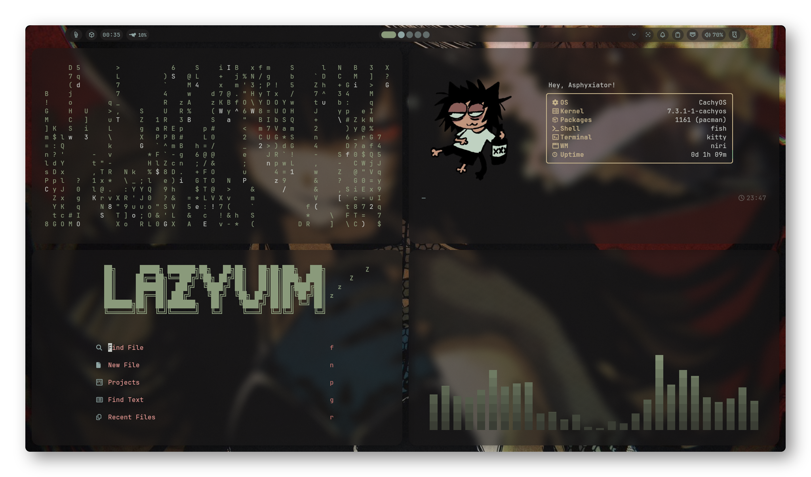
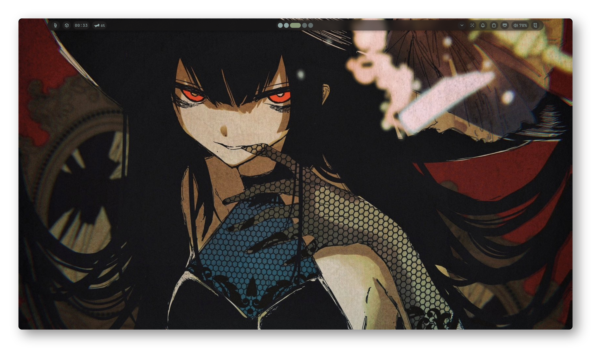
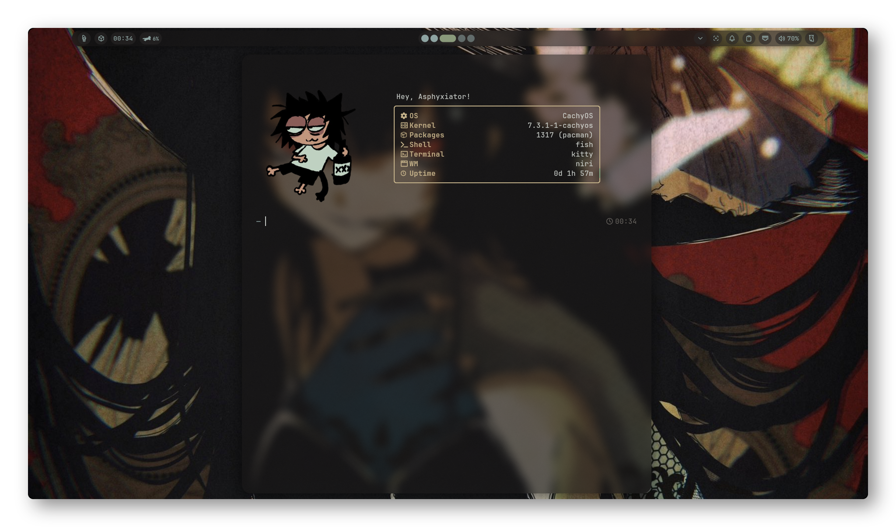

<div align="center">

# cachyos-rice

### A personal CachyOS desktop setup

*Minimal workflow. Carefully tuned details. Kanagawa Dragon colors.*

<br>



<br>

[](https://cachyos.org/)
[](https://github.com/YaLTeR/niri)
[](https://github.com/noctalia-dev/noctalia-shell)
[](https://sw.kovidgoyal.net/kitty/)
[](https://github.com/fastfetch-cli/fastfetch)
[](https://wayland.freedesktop.org/)

<br>


</div>

---

## `01` — About

My personal daily-driver setup on **CachyOS**, built around the **Niri** scrollable-tiling Wayland compositor and **Noctalia** desktop shell.

The visual style is based on **Kanagawa Dragon**: muted earthy tones, soft contrast and a little color without making the desktop feel busy.

## `02` — Screenshots

<div align="center">

### Desktop



### Overview


### Terminal



</div>

## `03` — Stack

| Category | Application |
|:--|:--|
| **OS** | [CachyOS](https://cachyos.org/) |
| **Compositor** | [Niri](https://github.com/YaLTeR/niri) |
| **Desktop shell** | [Noctalia](https://github.com/noctalia-dev/noctalia-shell) |
| **Terminal** | [Kitty](https://sw.kovidgoyal.net/kitty/) |
| **System info** | [Fastfetch](https://github.com/fastfetch-cli/fastfetch) |
| **Color scheme** | [Kanagawa Dragon](https://github.com/rebelot/kanagawa.nvim) |
| **Session** | Wayland |

## `04` — Repository

```text
cachyos-rice/
.
├── fastfetch
│   └── config.jsonc
├── kitty
│   ├── kitty.conf
│   └── themes
│       └── noctalia.conf
├── LICENSE
├── niri
│   ├── cfg
│   │   ├── animation.kdl
│   │   ├── autostart.kdl
│   │   ├── display.kdl
│   │   ├── input.kdl
│   │   ├── keybinds.kdl
│   │   ├── layout.kdl
│   │   ├── misc.kdl
│   │   └── rules.kdl
│   ├── config.kdl
│   └── noctalia.kdl
├── noctalia
│   └── config.toml
├── README.md
├── screenshots
│   ├── overview.png
│   ├── preview-desktop.png
│   └── preview-terminal.png
└── wallpapers
    └── wallpaper.jpg
```

## `05` — Installation

> These dotfiles are tailored to my machine. Review the configuration and adjust paths, keybinds, outputs and autostart commands before using them.

**1. Clone the repository**

```bash
git clone https://github.com/mejivith/cachyos-rice.git
cd cachyos-rice
```

**2. Back up your current configs**

```bash
mkdir -p ~/.config-backup
cp -a ~/.config/niri ~/.config-backup/ 2>/dev/null
cp -a ~/.config/noctalia ~/.config-backup/ 2>/dev/null
cp -a ~/.config/kitty ~/.config-backup/ 2>/dev/null
cp -a ~/.config/fastfetch ~/.config-backup/ 2>/dev/null
```

**3. Copy the configs you want**

```bash
cp -a niri noctalia kitty fastfetch ~/.config/
```

Log out and back in if you replace your Niri configuration. Make sure the required applications are installed first.

## `06` — Credits

Thanks to the developers and communities behind:

- [CachyOS](https://cachyos.org/)
- [Niri](https://github.com/YaLTeR/niri)
- [Noctalia](https://github.com/noctalia-dev/noctalia-shell)
- [Kitty](https://sw.kovidgoyal.net/kitty/)
- [Fastfetch](https://github.com/fastfetch-cli/fastfetch)
- [Kanagawa](https://github.com/rebelot/kanagawa.nvim)

---

<div align="center">

**MIT License** · Made on CachyOS

</div>
